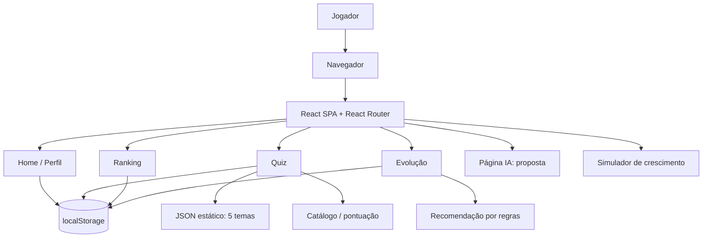
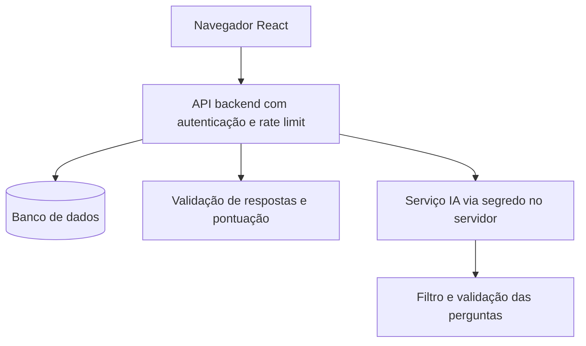

# Arquitetura e casos de uso — Happy Game

**Base da integração:** commit `a69a556be1c6d5aa5241b31470f28ee19ec00e8f`, com melhorias da Atividade 5 descritas nas evidências.

## Arquitetura implementada

O carregamento passa pela validação em `src/lib/validacaoPerguntas.js` e pelo sorteio Fisher–Yates em `src/lib/perguntas.js`, sem modificar o catálogo. Falhas preservam o fluxo de erro da interface. Cabeçalhos de hospedagem permanecem pendentes de autorização; consulte Segurança.

As rotas observadas em `src/App.jsx` são `/`, `/quiz`, `/ranking`, `/ia`, `/sobre`, `/projecao` e `/evolucao`. `public/data` contém 45 perguntas (cinco arquivos, nove perguntas por tema), com três perguntas por dificuldade. Não há requisição de IA externa, autenticação real ou serviço de banco de dados nesta versão.

## Casos de uso

1. Criar perfil local com nome e avatar.
2. Escolher categoria e dificuldade e responder três perguntas.
3. Receber feedback e pontuação (10, 20 ou 35 por acerto conforme dificuldade).
4. Consultar ranking local e progresso.
5. Seguir recomendação calculada por regras de desempenho.
6. Explorar simulação matemática de crescimento, sem dados de usuários reais.

## Dados e confiança

O perfil é armazenado sob `perfilHappyGame`. O progresso usa chaves com identificador de usuário, como `pontuacaoTotalHappyGame_<id>`, `quizzesConcluidosHappyGame_<id>` e `ultimoQuizHappyGame_<id>`. As validações de formato melhoram robustez, mas **o navegador controla os dados e a pontuação**. Não há barreira de confiança de servidor.

## Arquitetura futura (não implementada)

A arquitetura futura depende de escolha de provedor, credenciais, orçamento e avaliação de segurança. Nenhuma dessas integrações foi ativada nesta proposta.
